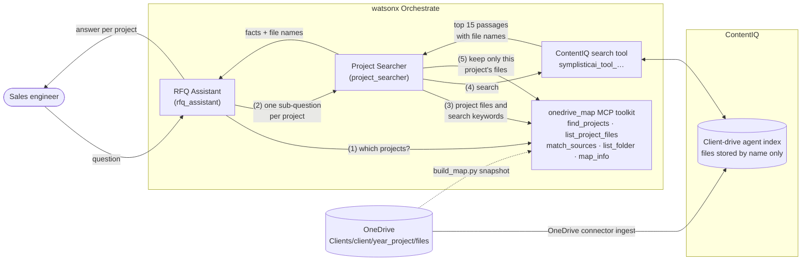

# ContentIQ exploration: project-scoped search over a client drive

Sales engineers answer RFQs from a deep client drive: `Clients/<client>/<year>_<project>/<files>`, with many similar projects. A question is usually about one project, or compares the current project with an older one. This repo shows how to answer such questions with Symplistic **ContentIQ** and **IBM watsonx Orchestrate (wxO)**, searching one project instead of the whole drive.

ContentIQ indexes the drive but stores each file under its **file name only**, and a search can't be limited to a folder. So we add two wxO agents and a small **folder-map MCP server**. They work out which project folder a question is about, search ContentIQ, and keep only the passages from that project's files.

Everything in `synthetic_data/` is fictional: clients, projects, sites and values.

## Architecture



1. **RFQ Assistant** splits the question by project or time period ("the current Azul project" and "the one ten years ago") and resolves each part to a project folder with `find_projects`. If several projects fit, it asks the user which one.
2. It sends each part to **Project Searcher**, together with the project path.
3. Project Searcher calls `list_project_files` to get the project's file names and a search phrase (client, year, project).
4. It searches ContentIQ through the search tool that ContentIQ created in wxO. Each call returns the top 15 passages from the whole drive, with their file names.
5. `match_sources` compares those file names with the project's files. Only passages from this project are kept. A file name that exists in several projects is used only if the passage text names this project.

More detail: [`docs/architecture/project-searcher.html`](docs/architecture/project-searcher.html) (open it locally in a browser) and [`backend/README.md`](backend/README.md).

## What's in the repo

| Path | What it is |
|---|---|
| `synthetic_data/` | The two synthetic data sources (see below) |
| `backend/` | Folder-map MCP server (`onedrive_map/`), `build_map.py` and `smoke_test.py` |
| `wxo/` | Agent definitions (`project_searcher.yaml`, `rfq_assistant.yaml`) and `ask.py`, which asks an agent through the API and prints every tool call |
| `scripts/deploy_wxo.sh` | Builds the map, uploads the toolkit and imports both agents |
| `docs/` | [`FOLDER_SCOPING.md`](docs/FOLDER_SCOPING.md) (findings: why ContentIQ can't search a subfolder), [`CONTENTIQ_GUIDE.md`](docs/CONTENTIQ_GUIDE.md) (UI, setup, API), [`RETRIEVAL_TEST.md`](docs/RETRIEVAL_TEST.md) (Q1–Q6 on `synthetic_data/sample_documents/`), [`INGESTION_PIPELINE.md`](docs/INGESTION_PIPELINE.md) (next idea), and architecture diagrams |

## The two data sources

Everything in `synthetic_data/` is made up. Details are in [`synthetic_data/README.md`](synthetic_data/README.md).

| | What it is | What it tests |
|---|---|---|
| **1. [`files_system_example/`](synthetic_data/files_system_example/)** | The full folder system of a client drive: `<client>/<year>_<project>/<files>`, with 40 clients, 400 projects and 1,242 one-line RFQ files. You upload it to OneDrive as `Clients`. | Whether a search can stay inside one project. The drive has the same site in different years, the same site under different clients, and 90 file names that occur in more than one project. |
| **2. [`sample_documents/`](synthetic_data/sample_documents/)** | Sample synthetic documents for one project (Bramhall Copper, 2021 Quebrada Azul Expansion): a gearless mill drive spec, datasheets, a mill data sheet, site conditions and a single line diagram, as PDF, DOCX and XLSX. | Whether a search finds values across formats: text, tables, spreadsheet cells and drawing callouts ([Q1–Q6](docs/RETRIEVAL_TEST.md)). |

## Set it up

### What you need

- A **ContentIQ** tenant (Starter plan is enough) connected to your wxO instance (ContentIQ → Settings → watsonx Orchestrate). See [`docs/CONTENTIQ_GUIDE.md`](docs/CONTENTIQ_GUIDE.md), section 4.
- A **watsonx Orchestrate** instance on IBM Cloud and an API key for it.
- A **OneDrive** account linked to ContentIQ (OneDrive Connect). SharePoint works the same way.
- Python 3.12.

### 1. Install

```bash
git clone https://github.com/tbbates1/content_iq_exploration.git
cd content_iq_exploration
python3.12 -m venv .venv
.venv/bin/pip install -r requirements.txt
cp .env.example .env      # then fill in WXO_API_KEY and WXO_SERVICE_URL (and CONTENTIQ_API_KEY for the API examples)
```

### 2. Load the synthetic client drive into ContentIQ

1. Create a folder named `Clients` at the top level of your OneDrive and upload the 40 client folders from `synthetic_data/files_system_example/` into it.
2. In ContentIQ, open **Connect → OneDrive**, select the `Clients` folder and create a new agent for it, for example `Client_Drive`. ContentIQ creates a wxO agent with the same name and a search tool for it.
3. Wait for the run to finish (**Ingest** page). It can take a few hours: in our test, ContentIQ processed about 6 small files per minute.
4. Find the name of the search tool and put it in `.env` as `CONTENTIQ_WXO_TOOL`:

   ```bash
   .venv/bin/orchestrate env add -n wxo -u "<WXO_SERVICE_URL>" --type ibm_iam
   .venv/bin/orchestrate env activate wxo --api-key "<WXO_API_KEY>"
   .venv/bin/orchestrate tools list -v | grep -oE 'symplisticai_tool[a-z0-9_]*' | sort -u
   # e.g. symplisticai_tool_client_drive_a_1234abcd5678
   ```

### 3. Deploy the toolkit and agents to wxO

```bash
scripts/deploy_wxo.sh
```

The script builds `backend/onedrive_map/folder_map.json` from `synthetic_data/files_system_example`, runs the smoke test, uploads the `onedrive_map` toolkit (wxO hosts the server, so nothing runs on your machine), and imports `project_searcher` and `rfq_assistant`. The agents use `azure-openai/gpt-5.4`. If your instance doesn't offer that model, change `llm:` in `wxo/*.yaml` (`orchestrate models list`).

### 4. Ask

```bash
.venv/bin/python wxo/ask.py rfq_assistant \
  "What drive power, pole count and supply voltage are in the RFQs for Bramhall Copper's 2021 Quebrada Azul Expansion, and what did we use on the 2016 Quebrada Azul Phase 1?"
```

Or chat with **RFQ Assistant** in the wxO UI. Expected answer:

| Project | File | Drive power | Poles | Supply |
|---|---|---|---|---|
| 2021 Quebrada Azul Expansion | `QAZ-21-RFQ-01.txt`, `QAZ-21-RFQ-02.txt` | 16,500 kW | 72 | 34.5 kV |
| 2016 Quebrada Azul Phase 1 | `QAZ-16-RFQ-01.txt` | 16,000 kW | 72 | 34.5 kV |
| | `QAZ-16-RFQ-02.txt` | 24,500 kW | 48 | 34.5 kV |
| | `QAZ-16-RFQ-03.txt` | 12,500 kW | 88 | 34.5 kV |
| | `QAZ-16-RFQ-04.txt` | 24,500 kW | 64 | 34.5 kV |

A vague question should make the agent ask which project you mean instead of guessing:

```bash
.venv/bin/python wxo/ask.py rfq_assistant \
  "What drive power and how many poles are in the current Azul project, and what did we use on the Azul installation ten years ago?"
```

## Limits

- Each ContentIQ search covers the whole client-drive agent and returns its top 15 passages. `match_sources` can only drop passages from other projects. It can't bring in passages that didn't make the top 15. The one-line sample files name their project, which makes this look better than it will on real documents.
- Files with the same name in different projects (90 names in the synthetic drive, shared by 187 files) may merge in ContentIQ, because it identifies files by name.
- The folder map is a snapshot of `synthetic_data/files_system_example`. Re-run `scripts/deploy_wxo.sh` after the drive changes. In production, the map would come from Microsoft Graph.
- What would fix this on the ContentIQ side (a folder path per file, a folder or file filter on search) is listed in [`docs/FOLDER_SCOPING.md`](docs/FOLDER_SCOPING.md#what-to-ask-symplistic).

## Single-project retrieval test

`synthetic_data/sample_documents/` holds one fictional project's documents in several formats, with six test questions and expected answers in [`docs/RETRIEVAL_TEST.md`](docs/RETRIEVAL_TEST.md). Load `synthetic_data/sample_documents/` into a separate ContentIQ agent (for example `Project_Files`) to check retrieval across PDF, DOCX, XLSX and drawings.

## Next tasks

1. **Our own ingestion pipeline.** In our own UI, the user picks a folder in SharePoint or OneDrive. Our backend reads it through Microsoft Graph and uploads the files through the ContentIQ API, with the folder path in each file name. This removes name collisions, and the folder map stays current. See [`docs/INGESTION_PIPELINE.md`](docs/INGESTION_PIPELINE.md).
2. **Open the real file.** Today an answer only names the ContentIQ source. Add a tool that opens the file at its real location in SharePoint or OneDrive, so the user goes straight to the document.
