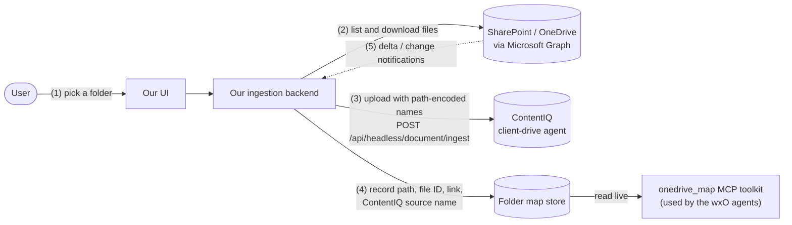

# Idea: our own ingestion pipeline

**Status:** idea, not built.

Today ContentIQ's OneDrive connector loads the `Clients` folder into one agent, and our folder map is a separate snapshot built from a local copy. The connector stores each file by name only, so files with the same name in different projects may merge, and a passage doesn't say which folder it came from. In our test it also processed only about 6 small files per minute, and the Starter plan allows only one scheduled job.

**The idea:** in our own UI, the user picks a folder in SharePoint or OneDrive. Our backend reads that folder through Microsoft Graph and uploads the files to ContentIQ through its headless API, with no ContentIQ connector involved. Because we do the upload, we choose each file's name in ContentIQ and keep the folder map up to date ourselves.

1. **Pick a folder.** The user signs in with Microsoft in our UI and picks a client or project folder. The UI can browse folders with Graph (`/drives/{drive-id}/items/{item-id}/children`) or use Microsoft's OneDrive/SharePoint file picker.
2. **List and download.** The backend walks the folder with Graph and downloads each file.
3. **Upload with path-encoded names.** Each file is renamed to include its folder path, for example `Bramhall_Copper__2021_Quebrada_Azul_Expansion__QAZ-21-RFQ-01.txt`. Files are then uploaded in batches with `POST /api/headless/document/ingest` (multipart `files`, `agent_id`, `agent_name`). Progress is tracked by the run's status endpoint.
4. **Record the map.** For each file, the backend stores its path, Graph item ID, `webUrl`, last-modified time and ContentIQ source name. The `onedrive_map` server reads this store instead of a snapshot.
5. **Stay in sync.** A Graph delta query on the drive, or a change-notification subscription, reports new, changed and deleted files. New and changed files are uploaded. Deleted files have their chunks removed (`DELETE /api/headless/milvus/chunks` with `{agent_id, source}`).

## What it fixes

- **No name collisions.** Path-encoded names are unique, even when two projects both have an `RFQ-01.pdf`.
- **Every passage carries its folder.** The source name says which client and project it came from, so `match_sources` is exact and answers can cite the folder.
- **The user picks the scope** in our UI, without going through the ContentIQ website.
- **No dependence on the connector's schedule**, and no limit of one scheduled job.

## What we know (tested 2026-11-09)

- `POST /api/headless/document/ingest` works with the API key. 2 `.txt` files were indexed in about 50 s, while a OneDrive run started in the UI was going on.
- ContentIQ keeps the uploaded file name as the source name.
- Uploaded files are found by the agent's wxO search tool. `project_searcher` answered from 20 uploaded Quebrada Azul files.

## Open questions

- **Speed and limits.** Only one ingest can run per API key at a time (another returns 409), and Starter allows 50 requests per minute. How many files, and how many MB, fit in one request? How fast is it with thousands of real PDFs?
- **Changed files.** Does re-uploading a name replace the old chunks or add to them? Plan: delete the source's chunks before re-uploading.
- **Drawings** need the CAD workflow (`ingestion_mode=cad`), so the pipeline has to route them by file type.
- **Graph access.** A work tenant needs an app registration approved by its IT, for example `Sites.Selected` for named SharePoint sites. A personal Microsoft account can't register an Entra app in its own directory.
- **Agents.** The API key can't create agents, so every folder goes into one agent that is created once in the ContentIQ website.
